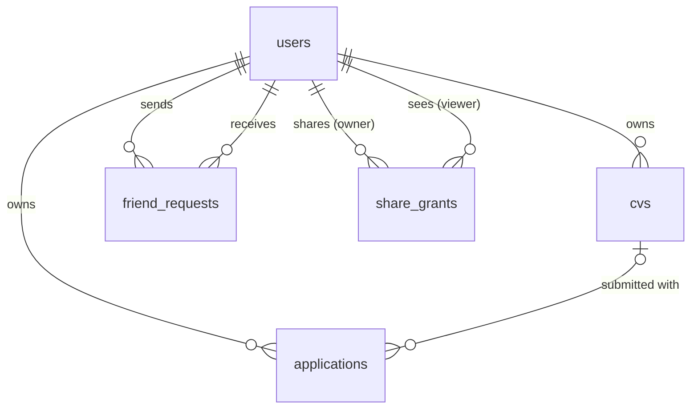

# internship-tracker
A full-stack internship application tracker for undergraduate students featuring priority deadline sorting, CV version management with custom exports, and social progress sharing. Made by the best group ever!

## backend schema:
```
app/
  __init__.py          # create_app() factory, config from env vars
  models/              # SQLAlchemy tables only, no logic
  services/            # all business rules live here
    applications.py    # CRUD, sorting/grouping, deadline math
    social.py          # friend requests, sharing permissions
    stats.py           # weekly counts, streak, leaderboard, gang score
    cvs.py             # upload/serve/delete CV files
  routes/              # Flask blueprints: thin, parse request → call service → render
    auth.py, home.py, applications.py, cvs.py, friends.py
  templates/
tests/                 # unittest, mostly against services/
Dockerfile, docker-compose.yml, .github/workflows/ci.yml
```

## Data model

 
## users
 
| Column | Type | Constraints | Notes |
| --- | --- | --- | --- |
| `id` | integer | PK | |
| `email` | varchar(255) | unique, not null | Stored lowercase |
| `password_hash` | varchar(255) | not null | werkzeug `generate_password_hash` |
| `username` | varchar(16) | unique, nullable | Null until the user finishes Name Your Rat. Letters, numbers, `_` |
| `avatar` | varchar(32) | not null, default `'grey'` | Key of the rat image |
| `timezone` | varchar(64) | not null, default `'America/New_York'` | Defines "today" and "this week" for streaks and stats |
| `created_at` | timestamp | not null | UTC |
 
## applications
 
| Column | Type | Constraints | Notes |
| --- | --- | --- | --- |
| `id` | integer | PK | |
| `user_id` | integer | FK → users.id, not null, on delete cascade | |
| `company` | varchar(120) | not null, default `''` | Blank when added from a bare link |
| `role` | varchar(120) | not null, default `''` | |
| `url` | varchar(2048) | nullable | |
| `status` | varchar(20) | not null, default `'to_do'` | One of `to_do`, `in_progress`, `applied`, `interviewing`, `offer`, `rejected` |
| `deadline` | date | nullable | |
| `is_rolling` | boolean | not null, default false | |
| `notes` | text | not null, default `''` | Never shown to friends |
| `cv_id` | integer | FK → cvs.id, nullable, on delete set null | Never shown to friends |
| `applied_at` | timestamp | nullable | Set the first time status becomes `applied`; never cleared. Drives stats, streak, leaderboard |
| `created_at` | timestamp | not null | |
| `updated_at` | timestamp | not null | Sorts the Closed section |
 
Indexes: `(user_id, status, deadline)` for the tracker, and `(user_id, applied_at)` for stats and the streak.
 
## cvs
 
| Column | Type | Constraints | Notes |
| --- | --- | --- | --- |
| `id` | integer | PK | |
| `user_id` | integer | FK → users.id, not null, on delete cascade | |
| `label` | varchar(80) | not null | `General SWE CV` |
| `filename` | varchar(255) | not null | Original name, for display only |
| `stored_path` | varchar(255) | unique, not null | Generated name on the uploads volume (e.g. a UUID + `.pdf`); never the user's filename |
| `uploaded_at` | timestamp | not null | |
 
The PDF itself lives on disk in a Docker volume. The database only stores where it is.
 
## friend_requests
 
One row per request. An `accepted` row is what makes two users friends.
 
| Column | Type | Constraints | Notes |
| --- | --- | --- | --- |
| `id` | integer | PK | |
| `from_user_id` | integer | FK → users.id, not null, on delete cascade | |
| `to_user_id` | integer | FK → users.id, not null, on delete cascade | |
| `status` | varchar(10) | not null, default `'pending'` | `pending`, `accepted`, `declined` |
| `created_at` | timestamp | not null | |
| `responded_at` | timestamp | nullable | |
 
Constraints: unique `(from_user_id, to_user_id)`, and check `from_user_id <> to_user_id`. The service layer also refuses a request when one already exists in the other direction.
 
Index: `(to_user_id, status)` for "incoming requests".
 
## share_grants
 
What one user lets one other user see. Each direction of a friendship has its own row, so each person controls their own sharing.
 
| Column | Type | Constraints | Notes |
| --- | --- | --- | --- |
| `owner_id` | integer | FK → users.id, on delete cascade | The person whose data it is |
| `viewer_id` | integer | FK → users.id, on delete cascade | The person allowed to see it |
| `share_board` | boolean | not null, default false | false = stats only; true = stats + board (name, link, status, deadline) |
| `count_in_gang` | boolean | not null, default false | Owner's applications add to the viewer's gang score |
| `created_at` | timestamp | not null | |
| `updated_at` | timestamp | not null | |
 
Primary key: `(owner_id, viewer_id)`. Index: `(viewer_id)` for "whose data can I see".
 
How rows appear over the lifecycle of a friendship:
 
| Event | What happens |
| --- | --- |
| A sends B a request | `friend_requests` row (A→B, pending) + `share_grants` row (owner A, viewer B) with A's checkboxes |
| B accepts | Request becomes `accepted` + `share_grants` row (owner B, viewer A) with B's checkboxes |
| B declines, or A cancels | Request becomes `declined` (or is deleted on cancel) + A's grant row is deleted |
| Either changes sharing | Update their own grant row |
| Either removes the friend | Delete the request row and both grant rows |
 
A grant only counts while the request is `accepted`. Before that, B can see what A offered but none of A's data.
 
## Derived values (not stored)
 
| Value | Computed from |
| --- | --- |
| Applied this week | `applications.applied_at` within Monday–Sunday in the user's `timezone` |
| Streak | Distinct local dates of `applied_at`, counted back from today (or yesterday) |
| Leaderboard | Applied-this-week counts for you + friends with an accepted request and a grant to you |
| Gang score | Your count + counts of friends whose grant to you has `count_in_gang = true` |
| Deadline banners | `status IN (to_do, in_progress)` and `deadline` within 3 days |
| Pending request badge | `friend_requests` where `to_user_id = you AND status = 'pending'` |
 