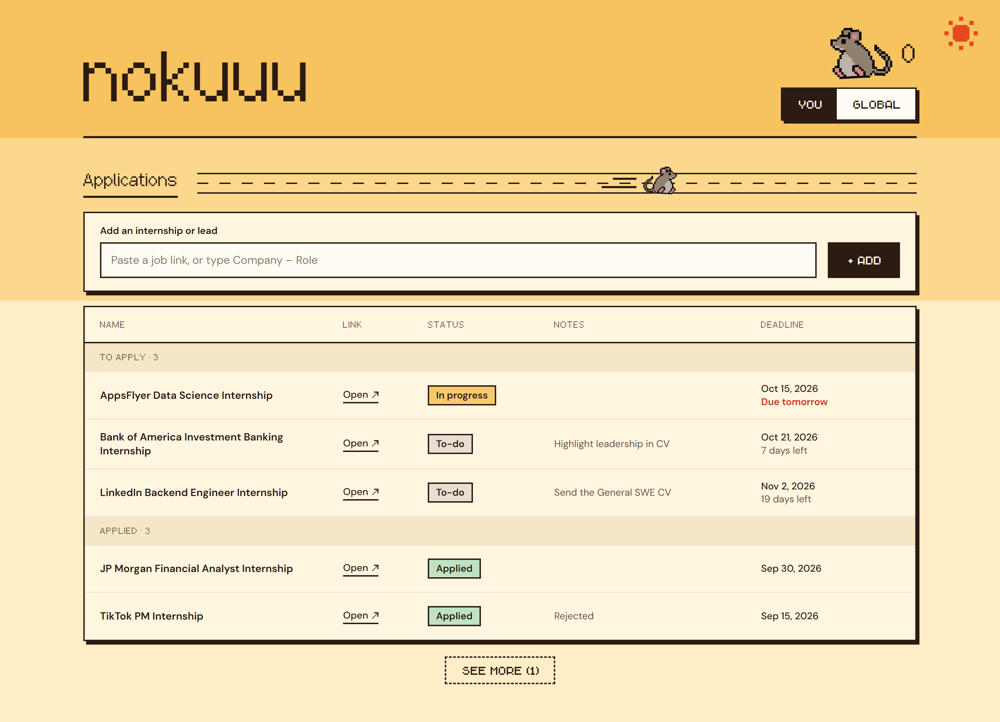
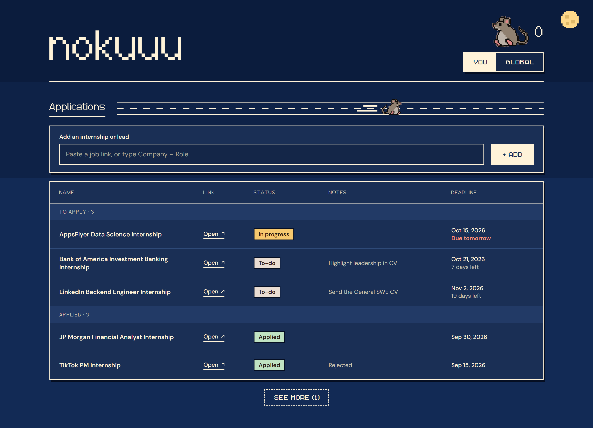

# Rat Race Design Doc

Nov 2, 2026 · Nokutenda Chimbetete

This is a copy of the [live doc](https://claude.ai/artifact/1dN1Rd2y3DDzae11cAuPV3), which may be newer.

## The feeling

Logging into Rat Race should feel like silly excitement. Applying for internships is depressing and serious, so the app brings the levity.

The humor comes from Wacky Races and kart games. The interface stays minimal, so the silliness lives in one place: the racing rat.

## Principles

When these conflict, the higher one wins.

1. **Laugh at the race, never at the person.** Jokes target the absurd process, not someone's rejections or low count.
2. **Logging comes first.** Any effect that slows down adding or updating an application gets cut.
3. **Minimal where possible.** If something doesn't help someone log or check an application, leave it out.
4. **Calm page, one loud moment.** The tracker stays quiet and easy to scan, so the racing rat stands out.
5. **Same place, different light.** Night mode is the same UI after dark, in dark blue with a moon instead of a sun.

## The look

The UI follows the template in `frontend-design`: cream panels, dark outlines and hard shadows. Only MVP features get built, so the Document Manager, streaks and email invites stay out.

These are reference images, and Figma becomes the source of truth once screens exist. The tag colors shown are placeholders.

Each color has one job. Red means urgent: something you can still act on.

### Color: desert gold

The page uses three stepped bands. The first edge sits on the header line, the second sits between the add box and the table, and the last band runs to the bottom. Each section paints its own background, so the edges stay aligned when the layout changes.

| Role | Day | Night |
| --- | --- | --- |
| Header band | #F7C35F | #0B1C3D |
| Middle band | #FBD88E | #0E2247 |
| Lower band | #FEEDC6 | #122A55 |
| Panel | #FFF6E0 | #1A2F55 |
| Text and outlines | #2B1B12 | #FFF3D9 |
| Secondary text | #67503F | #C9C2B0 |
| Action button | #2B1B12 | #FFF3D9 |
| Action button text | #FFF6E0 | #1A2F55 |
| Urgent | #C9301A | #FF9478 |
| Sun or moon | #E5491F | #FFD98A |

Text colors on panels pass WCAG AA contrast (4.5:1 or higher) in both modes, and main and secondary text also pass on every band. The sun or moon can double as the day/night switch.

### Tag colors: suggestions

These aren't decided. Our design teammate picks the final colors, and these are only starting points.

| Status | Suggestion | Why |
| --- | --- | --- |
| To-do | Neutral taupe | Nothing has happened yet, so it stays quiet |
| In progress | Pale teal | Stands out from the gold page |
| Applied | Pale green | Marks real progress |
| Interviewing | Pale blue | Needs to look different from In progress |
| Offer | Strong green | The best outcome gets the strongest tag |
| Rejected | Gray | Red is for things you can still act on |

Avoid yellow, which blends into the gold page, and purple, which we ruled out. Tag text should reach 4.5:1 contrast in both modes.

### Type

| Use | Font | Size |
| --- | --- | --- |
| Titles and labels | Pixelbasel | Multiples of 16px, such as 16, 32 or 48px |
| Buttons | Chava | 14–16px |
| Everything else | DM Sans | 14px minimum |

Each font has one job. Pixelbasel's pixels stay crisp at multiples of 16px, and it comes in one thin weight, so don't fake bold. It has no arrows, so the arrow in "Open ↗" should be an icon. Chava only has capitals, so all button labels appear in caps.

## Juice

For the MVP, the juice is one moment: when an application is marked Applied, your rat races.

- **Where:** a thin road beside the Applications heading.
- **What:** your rat sprints across with speed lines, then settles back, all in under a second.
- **Art:** it moves the rat's existing image, so all 8 rats work without extra animation frames.
- **Rules:** it only fires on a change to Applied, never blocks the next click, and restarts if triggered again. `prefers-reduced-motion` skips the movement.

Reactions for the leaderboard, offers and rejections wait until after the MVP.

## After the MVP: onboarding

A new user's first application is a fake internship so simple and silly that it's funny. It gives them the full juice before they've done any real work, and teaches the real flow along the way.

1. Sign up, name your rat and pick one of the 8 rats.
2. A joke listing appears, such as Head Cheese Taster at Big Cheese Inc. (placeholder joke).
3. Add it to your tracker, the same way you'd add a real one.
4. Apply with one absurd click, then mark it as Applied and get the full reaction.
5. Land on your real tracker, ready to add your first real application.

Rules: it can be skipped, it takes under a minute, and the fake application never counts on the leaderboard or stays in the tracker.

## Open questions

- [ ] Can we commit Chava to our public repo? Its license doesn't allow publishing the font without the author's written permission. If we can't get that, Pixelbasel takes over the buttons at a larger size.
- [ ] What are the final tag colors? The roadmap's Yellow = Interviewing, Green = Offer, Red = Rejected needs to match them.
- [ ] Does night mode also follow the device setting, or is it manual only?
- [ ] Who draws the 8 rats, and how long will that take?
